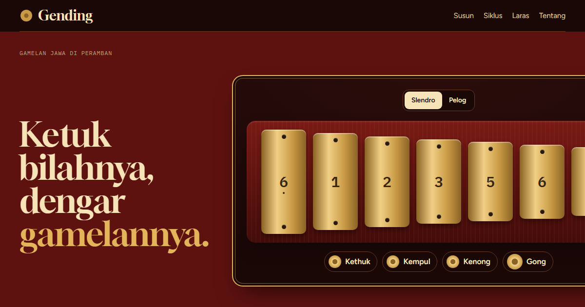

# Gending



**[Buka Gending](https://gending.raffstw.my.id)**

Gamelan Jawa yang bisa dimainkan di peramban. Semua bunyi disintesis dengan Web Audio,
tanpa satu pun rekaman.

- **Saron** tujuh bilah dalam laras slendro atau pelog, bisa ditabuh dengan klik, sentuhan,
  atau tombol 1–7; kethuk, kempul, kenong, dan gong bisa ditabuh sendiri-sendiri.
- **Penyusun balungan**: tulis kerangka lagu dalam notasi kepatihan (angka 1–7, titik untuk
  pin, `'` oktaf atas, `,` oktaf bawah), pilih bentuk **lancaran**, **ketawang**, atau
  **ladrang**, lalu putar. Gong, kenong, kempul, dan kethuk otomatis jatuh di ketukan yang
  benar; demung menebalkan balungan; peking menabuh nada yang dituju dua kali per ketukan.
- **Lingkaran siklus gongan** yang berputar mengikuti ketukan, dan notasi per gatra lengkap
  dengan tanda ricikan.
- **Perbandingan laras**: slendro, pelog, dan dua belas nada piano dalam satu oktaf, bisa
  diketuk untuk didengar.
- Balungan, laras, bentuk, dan tempo tersimpan di tautan, jadi bisa dibagikan.

## Bunyi

| Ricikan | Sintesis |
|---|---|
| Saron, demung, peking | parsial bilah logam 1 : 2,76 : 5,4, kembaran +4 sen untuk ombak, bunyi pukulan dari derau tersaring |
| Kenong, kempul | frekuensi dasar kuat, parsial ×2 dan ×3 lemah, dua osilator berselisih 1–2 Hz untuk denyut |
| Gong ageng | sekitar 45 Hz, denyut 0,9 Hz, dengung lebih dari enam detik |
| Kethuk | nada rendah yang langsung diredam |

Semuanya melewati gaung sintetis (tanggapan impuls dari derau yang meluruh) dan pemampat.
Ketukan dijadwalkan pada jam audio dengan pola "lihat ke depan" 120 ms, jadi tempo tetap rapi
walau tab sibuk.

Laras memakai jarak rata-rata kasar (slendro hampir rata 240 sen; pelog 0, 120, 270, 540,
675, 785, 950 sen) dan disetel tumbuk 6. Gamelan sungguhan punya embat sendiri-sendiri.
Pola contoh disusun untuk latihan, bukan gending tradisional, dan bonang, kendang, gender,
serta sindhen tidak disertakan.

## Menjalankan

```
npm install
npm run dev
npm test        # laras, notasi kepatihan, struktur kolotomik (vitest)
npm run build
```

Vite + TypeScript, tanpa framework dan tanpa pustaka audio. Huruf: Plus Jakarta Sans
(Tokotype), DM Serif Display, IBM Plex Mono.
